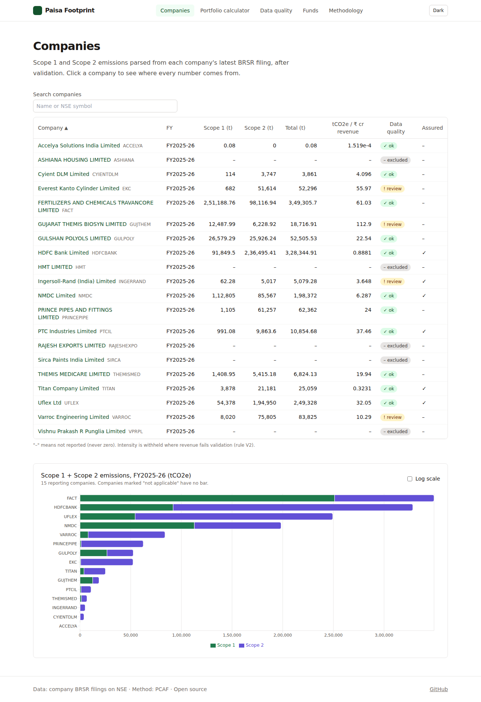
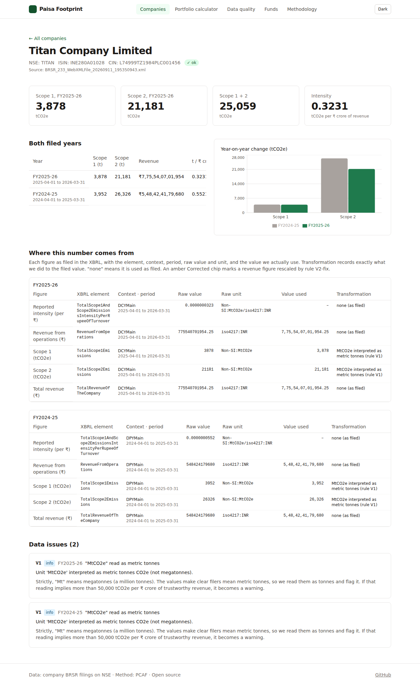
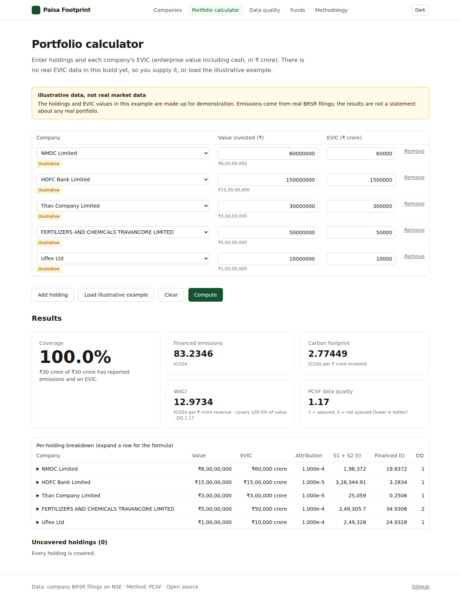

# Paisa Footprint

Paisa Footprint computes the **financed emissions** of Indian equity portfolios with the PCAF method, using companies' own BRSR filings to NSE. Every number traces back to a filing, an XBRL element and a formula, and every filing passes validators that catch real reporting errors.

| Companies | Where a number comes from | Portfolio calculator (illustrative) |
|---|---|---|
|  |  |  |

More, including phone-width captures: [docs/screenshots/](docs/screenshots/).

> **Status:** run 2. Emissions come from **20 real BRSR filings (FY2025-26)**, with 14 data problems caught in 6 companies (plus 26 informational notes). There is **no real fund-holdings, market-cap or debt data yet**: the demo portfolios and EVIC values are synthetic and labelled "illustrative" everywhere they appear.

## Quickstart

Backend (Python 3.12):

```bash
python3.12 -m venv .venv && source .venv/bin/activate
pip install -e ".[dev]"
pf build-snapshot --input tests/fixtures/brsr --out data/snapshots/fixtures
uvicorn api.main:app --reload            # API docs at http://localhost:8000/docs
```

Frontend (Node 20+):

```bash
cd web
npm install
npm run dev                              # http://localhost:5173
```

Set `VITE_API_URL` if the API is not on `http://localhost:8000`.

Or run both with Docker: `docker compose up --build`, then open http://localhost:8080.

Windows (PowerShell) commands are in [docs/MORNING_REVIEW.md](docs/MORNING_REVIEW.md).

## Command line

```bash
pf parse <file.xml>                                   # one filing as JSON
pf validate tests/fixtures/brsr                       # validation_report.csv + counts per rule
pf build-snapshot --input tests/fixtures/brsr --out data/snapshots/fixtures
pf compute --portfolio tests/fixtures/synthetic/portfolio_synthetic_a.csv \
           --evic tests/fixtures/synthetic/illustrative_evic.csv          # or --evic-real <csv>
pf fetch-brsr --out data/raw/brsr --from 2022-01-01   # laptop only: NSE blocks cloud servers
pf ingest-funds --input data/raw/amc --out data/snapshots/<YYYY-MM>/funds.parquet
pf rank-funds --snapshot data/snapshots/<YYYY-MM> --evic-real <csv>
duckdb < sql/coverage.sql        # coverage report (needs the DuckDB CLI; tests run it via Python)
```

Owner runbooks: [RUN_ON_LAPTOP.md](docs/RUN_ON_LAPTOP.md) (NSE download),
[EVIC_DATA_PLAN.md](docs/EVIC_DATA_PLAN.md), [AMC_DATA_PLAN.md](docs/AMC_DATA_PLAN.md),
[DEPLOY.md](docs/DEPLOY.md).

## Tests

```bash
ruff check . && ruff format --check . && mypy pf_core && pytest
cd web && npm run lint && npm run build && npm test
```

Tests use fixtures only and never call NSE or any other network source.

## Project structure

```
pf_core/            pure Python core, no web code
  brsr/             parser.py (XBRL → BrsrFiling), validators.py (V1–V6, V9, V10),
                    normalise.py (safe fixes only), config.py (thresholds + reasons)
  pcaf/             engine.py (pure PCAF arithmetic), quality.py, models.py, inputs.py (loaders)
  snapshot.py       builds and reads Parquet snapshots
cli/pf.py           Typer CLI: parse, validate, build-snapshot, compute
api/main.py         read-only FastAPI over a snapshot
web/                React + TypeScript + Vite + Tailwind + Recharts
sql/coverage.sql    DuckDB coverage report
tests/              pytest + hypothesis; fixtures/brsr (20 real filings, read-only), fixtures/synthetic
docs/               design doc, methodology, worked example, decisions, morning review
```

## Status & limitations

- **20 filings only**, skewed towards smaller late filers. `pf fetch-brsr` is ready to run on a laptop (NSE blocks cloud servers); see RUN_ON_LAPTOP.md.
- **No real EVIC.** The demo's EVIC values are made up and labelled; `--evic-real` loads and validates real data once you have it.
- **No real mutual-fund data.** The AMC ingestion and ranking pipeline is built and tested only on a synthetic workbook; the Funds page says so.
- **Scope 3 is excluded**, and companies that do not report emissions are **uncovered, not estimated**.
- **Revenue corrections are inferences.** Lakh/crore slips are corrected only when the second revenue field makes the reading unambiguous (rule V2-fix), always shown with a "Corrected" chip and capped at data quality 2.

How the numbers are computed, and why: [docs/METHODOLOGY.md](docs/METHODOLOGY.md). A full hand calculation: [docs/worked-example.md](docs/worked-example.md).
