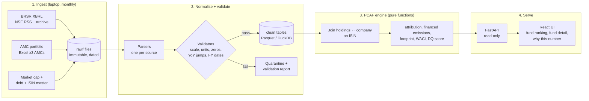
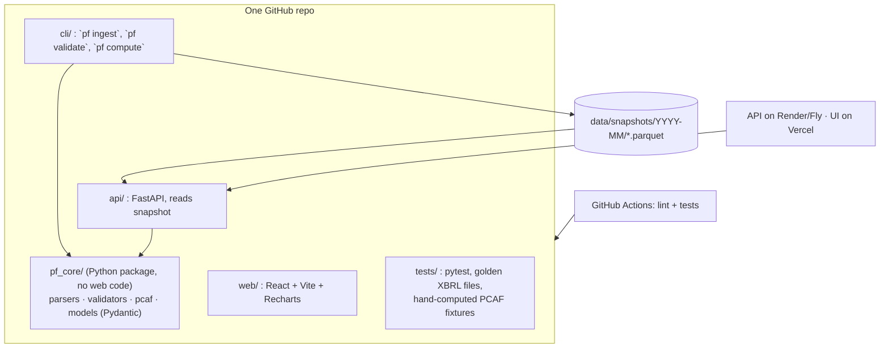

# Design doc v0: Financed emissions of Indian equity mutual funds

*Working name: **Paisa Footprint** (rename freely). Draft 13 Oct 2026. Confidence tags: [Certain] checked, [Likely] strong inference, [Guessing] to verify.*

---

## 1. Abstract
Indian investors can see a fund's returns, expense ratio and top holdings, but not how much greenhouse gas their money finances. This project computes **financed emissions** for Indian equity mutual funds using the **PCAF** method, the global standard banks and asset managers use. The inputs are all public: companies' own BRSR filings to NSE, AMC monthly portfolio disclosures, and market and balance-sheet data. Every number on screen traces back to a filing and a formula, and every input passes a set of validators that catch real reporting errors found in BRSR data. Examples include revenue typed at the wrong scale, "MtCO2e" used to mean tonnes, and zeros used for missing data. Each figure carries a PCAF data-quality score so users know how much to trust it.

**One-line pitch:** *How much carbon does ₹1 crore in your mutual fund finance? Computed with PCAF from companies' own filings, with every number traceable.*

**Not in scope:** ESG ratings, "green" recommendations, return predictions, or estimating emissions with ML where a company didn't report them. The MVP leaves those holdings out and reports them as a coverage gap, not as a guess.

---

## 2. The calculation (all arithmetic, all checkable)

For one fund, as of a portfolio date:

```
for each equity holding h in the fund:
    attribution_h      = value_h / EVIC_company
    financed_em_h      = attribution_h × (Scope1 + Scope2)_company          [tCO2e]

fund_financed_emissions = Σ financed_em_h                                    [tCO2e]
carbon_footprint        = fund_financed_emissions / covered_value × 1e7      [tCO2e per ₹ crore invested]
coverage                = covered_value / total_equity_value                 [%]
weighted_avg_intensity  = Σ (weight_h × (S1+S2)/revenue_company)             [tCO2e per ₹ crore revenue]  (WACI)
```

- **EVIC** (enterprise value including cash) = market cap at fiscal year end + total debt (+ minority interest). [Likely, per PCAF; confirm the exact definition in PCAF Part A before coding]
- **Data-quality score per holding** (PCAF listed equity): **1** = reported and assured, **2** = reported but not assured. [Certain, per the [PCAF data-quality table](https://ditchcarbon.com/resources/guides/pcaf-data-quality-by-asset-class)] BRSR has a field saying whether GHG figures were assured by a third party, so we can assign 1 vs 2 directly. [Certain the field exists, from your 20 filings] Holdings without reported emissions get no score in the MVP and count against coverage.
- **Fund score** = value-weighted average of holding scores.
- **WACI** needs no EVIC, so it's the fallback metric when EVIC data is missing.

Every result row stores its inputs and their sources (filing URL, field, period), so the UI can show a "why this number" breakdown.

---

## 3. Data sources

| Data | Source | Status |
|---|---|---|
| Scope 1, Scope 2, revenue, assurance flag | NSE BRSR XBRL (`TotalScope1Emissions`, `TotalScope2Emissions`, `RevenueFromOperations`, `WhetherDetailsOfGreenHouseGasEmissionsAndItsIntensityIsAssuredByAssurer`) | [Certain] Tested on 20 real filings, 15/20 report Scope 1+2 |
| Fund holdings (ISIN, quantity, market value, % of NAV) | AMC monthly portfolio Excel files (SEBI-mandated) | [Certain] they exist; [Guessing] how messy each AMC's format is. Start with 3 AMCs |
| Market cap at 31 March | NSE "market capitalisation of all companies" report (updated March and December) | [Likely], verify in week 2 |
| Total debt | NSE financial-results XBRL (borrowings, current + non-current) | [Guessing] on field names, verify in week 2 |
| ISIN ↔ NSE symbol ↔ company | NSE equity master list | [Likely] |
| Cross-check | [Dataful BRSR emissions dataset](https://dataful.in/datasets/20264/) (top 1,000 companies, FY20–FY26) | Used only to compare against our parsed values, never as the source |

**Hard constraint:** NSE blocks this cloud environment. It may also block GitHub Actions runners [Guessing]. So **data refresh runs on your laptop**, which writes versioned Parquet snapshots. The deployed app reads only snapshots and never calls NSE live.

---

## 4. Flow



## 5. Architecture



**Stack:** Python 3.12, pandas, lxml, Pydantic, DuckDB (no database server needed; Parquet in, SQL out), FastAPI, pytest + hypothesis, React + Vite + Recharts, Docker, GitHub Actions. This uses less infrastructure than Postgres, and the data is small (about 1,000 companies × a few hundred fund holdings).

---

## 6. Validators (from the real data check)
| # | Rule | Found in |
|---|---|---|
| V1 | `MtCO2e` → tonnes; flag if implied intensity > 50,000 t per ₹ crore | 10/15 filings |
| V2 | Revenue < ₹10 lakh for a listed company → scale error; recompute intensity from financial results | Gujarat Themis, Everest Kanto |
| V3 | `RevenueFromOperations` vs `TotalRevenueOfTheCompany` differ > 2× → flag | Everest Kanto |
| V4 | A zero year next to a non-zero year → treat as missing, not zero | Gulshan Polyols |
| V5 | Year-on-year change > 2× → flag for review (don't auto-fix) | Varroc |
| V6 | Carry fiscal-year dates and never assume April to March | Accelya (June year end) |
| V7 | Holding ISIN not matched to any company → report it, never drop it silently | to be seen |
| V8 | Fund holdings % of NAV must sum to 95–105% | to be seen |

Each validator is a pure function with its own test built from the real failing example.

---

## 7. What we'll measure (proof it works)
- **Parser accuracy:** for 30 randomly picked companies, compare parsed Scope 1/2 by hand against the BRSR PDF. Target: 30/30, with every miss explained.
- **Agreement with Dataful:** % of companies where our value is within 1% of theirs. Investigate and document every disagreement, since that's where you either catch their mistakes or find yours.
- **Validator hit rate:** how many filings each rule flags across all ~1,000 companies. This becomes a mini-report on BRSR data quality in India, which is a strong portfolio piece in its own right.
- **Engine correctness:** 3 hand-computed fixture portfolios in a spreadsheet, with the engine matching to the rupee. Property tests check that attribution never exceeds 1 and that splitting a holding in two leaves the total unchanged.
- **Coverage per fund:** % of value with reported emissions, shown prominently next to every footprint.

---

## 8. Build plan (6 weeks)

| Week | Build | Done when |
|---|---|---|
| **1** | Repo, CI, BRSR parser + validators V1–V6 run over all available filings | `pf validate` produces a validation report across ~1,000 companies, and 30 are hand-checked against PDFs |
| **2** | ISIN master, market cap at 31 March, total debt → EVIC table; Dataful cross-check | EVIC available for ≥ 80% of the top 500 companies |
| **3** | AMC adapters for 3 AMCs (about 15 equity funds) + PCAF engine + fixtures | **MVP:** `pf compute` prints a fund ranking CSV that matches the hand-calculated fixtures |
| **4** | FastAPI + React: ranking table, fund detail, per-holding "why this number" | Runs locally with Docker Compose |
| **5** | Deploy; more AMCs; **stretch:** portfolio upload (same engine), sector-median estimates for non-reporters (marked DQ 4) | Public demo URL |
| **6** | README, method page, "BRSR data quality" write-up, demo video, resume bullets | Someone who has never seen it can audit one number end to end |

---

## 9. How this stays different from Carbonomics
Carbonomics measures an **institution's own** emissions. This project measures **the emissions an investor finances** through market holdings, using a finance-sector standard (PCAF), market data (EVIC) and fund portfolios. If an interviewer asks, the difference is "operational emissions vs financed emissions".

## 10. Open questions (resolve in week 1–2)
1. How far back does NSE's archive go, and can we list all BRSR filings rather than just the RSS's recent ones? [Guessing]
2. The exact field names for total borrowings in NSE's financial-results XBRL. [Guessing]
3. Which 3 AMCs have the cleanest portfolio files? Proposed: SBI MF, HDFC MF, Parag Parikh. [Guessing]
